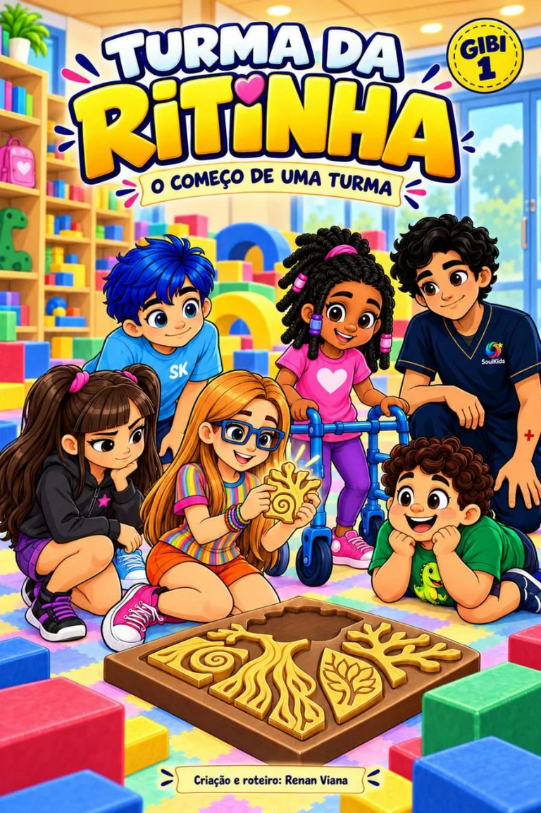

# Bíblia de Personagens — Turma da Ritinha / SoulKids
**Versão:** 1.0 • **Data:** 07/11/2026 • **Status:** especificação editorial de referência, com pendências explicitadas.

> **Regra central:** nunca inventar ou trocar características de personagens para preencher lacunas de um roteiro ou simplificar uma geração de imagem. "Ainda não definido" é uma informação válida. A bíblia serve para **reduzir retrabalho**, não para fingir que todas as referências antigas são consistentes.

## 1. Fontes e hierarquia de decisão
1. Instruções e aprovações **explícitas mais recentes** do criador prevalecem sobre versões antigas.
2. O **Gibi 1 publicado, com 48 páginas**, é a referência principal da continuidade narrativa e da aparência efetivamente publicada; especialmente **capa**, **páginas de apresentação dos personagens** e **página 46** para Ray. Pequenas variações em quadros não criam novos modelos.
3. Ilustrações individuais que passaram por **aprovação específica** podem detalhar poses, mas não prevalecem sobre características principais expressamente fixadas.
4. Roteiros e esboços antigos ajudam na reconstrução histórica, mas **não revogam correções posteriores**.
5. Não usar como cânone uma imagem promocional antiga, um resultado isolado de geração ou um arquivo cujo nome está trocado.

**Referências no repositório:**
- [Gibi 1 — versão publicada](../Turma_da_Ritinha_Gibi_1_O_Comeco_de_uma_Turma.pdf)
- [Capa oficial](../gibi1-capa.webp)
- [Ritinha caminhando — sprite atual](../ritinha-passos.webp)
- [Guia de voz já aprovada da Ritinha](../VOZ_RITINHA.md)

**Complemento recente para o jogo:** [Bíblia Visual SoulKids Play — versão 1.0](BIBLIA_VISUAL_SOULKIDS_PLAY.md), preparada a partir da prancha coletiva enviada pelo criador em 07/11/2026, com vistas e expressões dos sete personagens. Para novas telas e sprites **do jogo**, consultar primeiro esse complemento e seus alertas de divergência; ele não altera retroativamente o Gibi 1. O arquivo original da prancha ainda precisa ser arquivado no repositório. Os dados de implementação estão em [personagens-soulkids-play.json](../dados/personagens-soulkids-play.json).

## 2. Fichas de personagens

### Ritinha — protagonista
**Situação:** personagem principal, modelo reconhecível na capa e no Gibi 1.

**Visual de referência:** criança de cabelo longo e predominantemente liso, tom dourado/acobreado na arte publicada; óculos **azuis** de armação marcante; blusa de **listras verticais multicoloridas**; short em tonalidade amarela/alaranjada conforme quadro-modelo aprovado; tênis **rosa**. No Gibi 1, a mochila é rosa, com detalhe colorido, e guarda as pistas. Conferir **sempre** a capa e as páginas 12, 28 e 37, em vez de fixar um tom exato por descrição textual.

**Personalidade e ação:** observadora, pode ser tímida diante de novidade, experimenta no próprio tempo, conquista autonomia progressiva; tem iniciativa e não é representada como incapaz. No início do Gibi 1 pede para observar antes de entrar.

**Voz:** próxima da criança, curiosa, expressiva e sem frases didáticas longas. Bordão **aprovado**: **“Tá goxxxtando ou tá amando?!”**, esporádico; não a cada fase. A voz sintetizada já selecionada para as páginas interativas deve seguir [VOZ_RITINHA.md](../VOZ_RITINHA.md); não substituí-la sem aprovação.

**Não fazer:** remover os óculos, trocar listras verticais por horizontais, dar cabelo muito cacheado, inventar outra roupa, transformar a protagonista em narradora de explicações clínicas.

### Ravi — psicomotricista e mediador da turma
**Situação:** personagem adulto do Gibi 1.

**Visual de referência:** homem jovem, cabelos pretos escuros ondulados/cacheados, **sem barba**, sem óculos e sem apito; uniforme azul-marinho, com marca SoulKids corretamente posicionada. Não trocar pela aparência de um adulto genérico nem por uma versão barbeada de outra personagem.

**Personalidade e ação:** acolhedor, brincalhão com moderação, observa antes de intervir, respeita escolhas, se coloca na altura da criança. Modela caminhos sem executar a tarefa inteira por ela.

**Bordão oficial:** **“Boa, jovem!”**, reservado a conquistas ou tentativas relevantes. “Jovem” pode aparecer em outras falas curtas com moderação. **“Aí eu gostei!” está SUBSTITUÍDO e não deve voltar como bordão.**

**Não fazer:** repetir “Boa, jovem!” a cada clique, parecer um fiscal ou um adulto que resolve tudo pela turma.

### Tonico — comunicação econômica e participação pelo ritmo
**Situação:** integrante da turma, já conhecido da clínica quando Ritinha chega.

**Visual de referência:** menino pequeno de **cabelo azul vivo**, camiseta **azul-clara com “SK”** na frente no Gibi 1, short azul-escuro e tênis claro. Proporções infantis menores do que as de Ravi. A imagem individual atualmente chamada **“movimento-tonico.webp” não corresponde ao Tonico do Gibi publicado**; ver auditoria abaixo.

**Personalidade e ação:** fala pouco, pode repetir falas depois de um tempo, encontra maneiras de compartilhar atenção pela ação. Participa de argolas, encaixes, turnos e ritmos. Não é obrigatório verbalizar uma conquista.

**Marca de comunicação:** **“Toc, toc!”** (toque/ritmo) como elemento de cena; **não** bordão obrigatório a cada aparição. Frases curtas e silêncio também caracterizam Tonico.

**Não fazer:** trocar pela criança de blusa verde com dinossauro; usar discurso longo; transformar particularidades de comunicação em piada ou diagnóstico.

### Luca — imaginação e dinossauros
**Situação:** integrante da turma.

**Visual de referência:** menino de corpo mais arredondado, cabelo castanho cacheado e volumoso, **camiseta verde com dinossauro**, short escuro e tênis claros/escuros conforme o modelo do Gibi 1 (ver páginas 28 e capa). Manter o desenho do dinossauro identificável.

**Personalidade e ação:** imaginativo, associa desafios a dinossauros e brincadeiras, pode pedir ajuda. Não deve ser definido apenas pelo peso ou pela pronúncia.

**Fala característica aprovada:** troca pontual de sons, com exemplo **“boritinha”**; usar em poucas falas e somente quando faz sentido. **“Ovo de dinossauro!”** é motivo narrativo, não bordão oficial permanente.

**Não fazer:** atribuir a ele o visual azul com símbolo de foguete que aparece no arquivo “movimento-luca.webp”; mudar todas as palavras artificialmente; associar o humor ao corpo.

### Maya — iniciativa, leitura do ambiente e participação
**Situação:** integrante da turma.

**Visual de referência:** menina negra, cabelo escuro em **tranças/dreads estilizados com acessórios rosa** na versão do Gibi publicado; blusa rosa com símbolo de coração, calça roxa, calçado rosa, **andador azul** como recurso funcional. Preservar o andador em toda sequência em que aparece, incluindo sua posição e sua relação com as mãos e o deslocamento.

**Personalidade e ação:** observadora, participativa, contribui para encontrar alternativas de caminho e percebe detalhes que passam despercebidos por outros personagens. Tem iniciativa.

**Bordão:** **não definido/aprovado**. Exemplos de fala do gibi (“Vamos pela volta. Ali cabe todo mundo.”) demonstram como pensa, mas **não** devem virar bordões automáticos.

**Não fazer:** apagar o andador sem motivo narrativo, gerar rodas ou apoios inconsistentes, resumir o papel da personagem à mobilidade, inventar um bordão.

### Lia — frustração, regulação e retorno à brincadeira
**Situação:** integrante da turma.

**Visual de referência:** menina de corpo mais esguio, cabelo castanho-escuro em duas marias-chiquinhas com acessórios rosa; **blusa/casaco escuro** com detalhe rosa; short roxo; tênis escuros com detalhes rosa. Conferir capa e página 37.

**Personalidade e ação:** pode reagir de forma intensa a um desafio, frustrar-se, precisar de tempo, escolher retomar e conseguir participar. A história mostra **frustração → pausa/regulação → retorno por escolha**, não obediência forçada.

**Expressão característica:** **“NÃO!”** como reação inicial em situações relevantes; não precisa abrir todas as falas. Depois pode mudar de posição de modo crível.

**Não fazer:** transformar “NÃO!” em piada repetitiva, retratá-la como vilã, obrigá-la a retornar imediatamente, modificar o porte físico ou colocar roupas brilhantes não aprovadas.

### Ray — psicóloga, introdução da próxima história
**Situação:** personagem adulta apresentada **somente na última sequência do Gibi 1**, como ligação com o Gibi 2.

**Visual de referência:** mulher adulta de cabelo longo castanho e ondulado/cacheado, **uniforme rosa de clínica** com logomarca SoulKids, conforme **página 46** do Gibi 1. O retrato fotográfico real não é modelo de ilustração e não deve ser estilizado automaticamente.

**Personalidade e ação:** acolhedora, segura, escuta e acompanha as crianças sem moralizar ou fazer a atividade por elas. Psicologia é apresentada de maneira narrativa, não por exposições clínicas em balões.

**Bordão:** **nenhum aprovado**. “Vamos com calma” é frase possível, mas **não bordão oficial**.

**Não fazer:** inseri-la em páginas anteriores do Gibi 1, trocar seu uniforme por azul-marinho, inventar uma profissão ou dar-lhe um discurso técnico extenso. Em **jogos independentes do Gibi 1**, sua participação pode existir desde que respeite o personagem e não altere a cronologia da HQ.

## 3. Bordões: regras de uso

| Personagem | Status | Expressão | Uso editorial |
|---|---|---|---|
| Ritinha | **Bordão aprovado** | “Tá goxxxtando ou tá amando?!” | Apenas em momento marcante; não por clique |
| Ravi | **Bordão aprovado** | “Boa, jovem!” | Conquista/tentativa significativa; “jovem” moderado |
| Tonico | **Marca expressiva** | “Toc, toc!” | Toque, ritmo ou interação; não repetir mecanicamente |
| Luca | **Padrão pontual de fala** | “boritinha” | Alteração fonética esporádica e natural |
| Lia | **Reação característica** | “NÃO!” | Quando há resistência; permitir mudança gradual |
| Maya | **Sem bordão aprovado** | — | Dialogar conforme contexto; não inventar assinatura |
| Ray | **Sem bordão aprovado** | — | Falar como personagem, sem frase fixa |

**Expressões revogadas ou não canônicas:**
- Ravi: **“Aí eu gostei!”** como bordão — **substituído por “Boa, jovem!”**.
- Frases propostas automaticamente para Maya e Ray em brainstorms anteriores — **não aprovadas como bordão**.
- Não deduzir bordões a partir de uma única fala do Gibi 1.

## 4. Regras de imagem e cenário
1. Usar **a mesma folha-modelo** em toda imagem de cada capítulo/jogo. A folha precisa conter rosto, frente, perfil, roupas, cor/acessórios e proporções; **nem todas essas folhas estão concluídas**.
2. Uma pose nova não autoriza mudar cabelo, corpo, roupa, calçado ou acessório.
3. A sala é **acolhedora, funcional e pouco hiperestimulante**. Equipamentos, cores e objetos devem ter função na cena; evitar excesso decorativo.
4. A **Árvore das Emoções fica na área externa**, vista pela janela/porta no final; **nunca** plantada no meio da sala.
5. O Gibi 1 tem **cinco peças/pistas**; Ritinha guarda as pistas na mochila. A estrela/peças não podem mudar arbitrariamente de formato ou contagem.
6. Ravi atua na altura da criança. Tonico já conhece a sala. Lia precisa de tempo de regulação. O andador de Maya não desaparece entre quadrinhos.
7. Balões seguem a leitura brasileira, sem cobrir rostos, mãos, andador, pistas, expressões ou ações centrais. Onomatopeias servem à ação, não à poluição visual.
8. Ray aparece somente no encerramento do **Gibi 1**, no gancho da Psicologia. A árvore não vira um cenário comum antes da descoberta.
9. **Não incluir diagnóstico, rótulos, estereótipos ou explicações clínicas dentro da ficção.** Conteúdo técnico fica na seção para responsáveis/profissionais.
10. Nunca substituir um personagem com imagem “parecida”; melhor usar uma composição tipográfica temporária do que um rosto inconsistente.

## 5. Jogos SoulKids: como aplicar a bíblia
**Rota da Ritinha 3.0 — orientações editoriais, não roteiro aprovado:**

| Momento | Papel dramático | Fala possível (rascunho; não bordão novo) |
|---|---|---|
| Abertura | Ritinha convida para descobrir a turma | “Vamos procurar meus amigos?” |
| Fase 1 | Encontrar Tonico; observar e escolher uma direção | Tonico reage com “Toc, toc!” ao encontro |
| Fase 2 | Encontrar Luca; imaginação com dinossauros | Luca fala de um “ovo de dinossauro” |
| Fase 3 | Encontrar Lia e Maya; escolher uma rota para todos | Maya sugere um caminho acessível; Lia pode hesitar e depois tentar |
| Conquista significativa | Ravi reconhece esforço | “Boa, jovem!” **uma vez**, quando couber |
| Encerramento | Fechar a aventura sem competir | Ritinha agradece e convida a voltar |

**Importante:** falas acima são **propostas para jogo**, não conteúdo já aprovado. Não gravar como áudio definitivo nem gerar centenas de ilustrações antes da aprovação do roteiro.

**Frustração construtiva:**
- Erro tem consequência **clara, previsível e proporcional**; numa versão com reinício, reiniciar **apenas a fase atual**, nunca todas as conquistas.
- Uma pequena reação sonora/visual pode acompanhar o erro, **sem punição, ridicularização ou mensagem de fracasso**.
- Evitar que um obstáculo invisível ou comando mal explicado cause frustração arbitrária.
- Deixar ajuda acessível e opções de acessibilidade (ritmo reduzido, som desligável, entradas alternativas). **Não obrigar a criança a caminhar**.
- Passagem automática de fase com oportunidade de pausar; não sacrificar acessibilidade por velocidade.
- Sem pontuação de diagnóstico clínico; o interesse principal é qualidade da participação e estratégias.

**Áudio:** a **voz aprovada da Ritinha** está em [VOZ_RITINHA.md](../VOZ_RITINHA.md). **Ravi, Ray e as crianças não têm vozes oficiais aprovadas nesta bíblia**. Efeitos sonoros novos também exigem verificação de volume e opção de silêncio. Nada de autoplay.

## 6. Auditoria: conflitos e bloqueios encontrados
| Questão | Evidência | Decisão segura |
|---|---|---|
| **Arquivos de Luca/Tonico parecem trocados** | \`movimento-luca.webp\` exibe menino azul com foguete; \`movimento-tonico.webp\` exibe menino de verde com dinossauro. **O Gibi 1 publicado mostra o inverso para os nomes.** | Não usar esses arquivos como folha-modelo; verificar/corrigir nomes e referências antes de usar em produção |
| **Cor/forma do cabelo da Ritinha varia entre roteiros antigos** | Anotações antigas divergem entre loiro/ruivo e liso/cacheado; nas correções do gibi, cabelo excessivamente ondulado foi rejeitado | **Visual publicado e modelo final aprovado** prevalecem; não transformar arte divergente em nova versão |
| **Short da Ritinha descrito como amarelo e como laranja** | Textos de planejamento antigos vs. capa/páginas publicadas | Usar **o mesmo tom da referência gráfica aprovada**, sem inventar hexadecimal; padronização nominal permanece pendente |
| **Maya: referência textual “dreads” vs. desenho detalhado** | Gibi mostra tranças estilizadas, acessórios rosa e andador azul | Preservar a estrutura visual efetiva do Gibi 1; não trocar penteado nem apagar o andador |
| **Ray: ausência de prancha frontal oficial em todos os arquivos** | Referência visível na página 46 e orientação do uniforme rosa | Não prometer folha-modelo de múltiplos ângulos até sua aprovação |
| **Ravi: bordão antigo** | Registros prévios contêm “Aí eu gostei!” | **Revogado**; manter “Boa, jovem!” em uso moderado |

Estes conflitos são **pendências editoriais explícitas**. Não foram resolvidos por geração de imagem ou suposição.

## 7. Checklist obrigatório de qualidade antes de publicar
- [ ] O personagem é reconhecível **sem ler o nome**?
- [ ] Cabelo, óculos, roupa, calçado e proporções coincidem com sua referência?
- [ ] Acessórios de mobilidade são preservados e desenhados funcionalmente?
- [ ] Os nomes dos arquivos correspondem ao personagem mostrado?
- [ ] Bordão oficial usado só quando há intenção narrativa? Nenhum bordão revogado?
- [ ] Fala do personagem condiz com idade, personalidade e contexto?
- [ ] Há continuidade de cenário/objetos/pistas entre cenas e telas?
- [ ] Há pouco ruído visual e contraste/legibilidade suficientes?
- [ ] Ninguém é definido por diagnóstico, corpo ou dificuldade?
- [ ] As falas do jogo estão separadas de explicações para adultos?
- [ ] O modo sem som e sem animação continua funcional?
- [ ] Um responsável consegue entender a atividade e as adaptações?
- [ ] A revisão foi feita olhando imagem **e** roteiro, não só o prompt de geração?

**Critério de bloqueio:** se uma característica de identidade mudar sem aprovação ou um acessório fundamental desaparecer, **não publicar**. Corrigir a imagem, não adaptar retroativamente a bíblia ao erro.

## 8. Fluxo de produção e alterações
1. **Roteiro curto aprovado:** ação da cena, personagem, emoção, fala e objetos necessários.
2. **Modelo e cenário fixos:** trabalhar com imagens de referência versionadas; escolher enquadramento e expressão, não reinventar o personagem.
3. **Primeira imagem de prova:** comparar visualmente com a referência; só depois produzir as demais.
4. **Validação narrativa e clínica:** verificar autonomia, comunicação, frustração proporcional, cuidado inclusivo e continuidade.
5. **Teste no celular:** texto, contrastes, som/mudo, responsividade e navegação; preservar desempenho.
6. **Publicação versionada:** registrar mudanças, manter reversão possível e atualizar a bíblia **apenas após aprovação**.

**Controle de versão:** qualquer mudança de bordão/roupa/identidade exige registro com data, personagem, decisão explícita e referência. Novas falas de jogo não viram automaticamente bordões.

---
**Estado da versão 1.0:** 7 personagens documentados; 2 bordões oficiais confirmados, 3 marcas expressivas/comunicativas, 2 personagens sem bordão; 6 alertas de consistência. A bíblia é **um documento de trabalho verificável**, não afirma que a padronização gráfica completa já foi realizada.